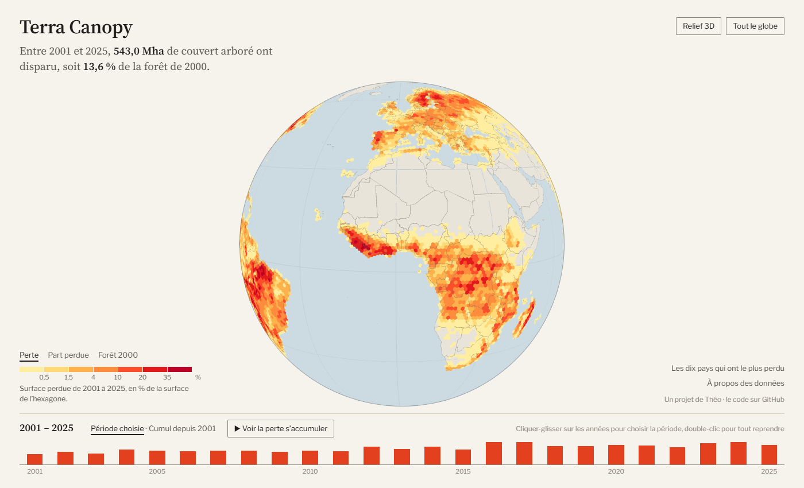
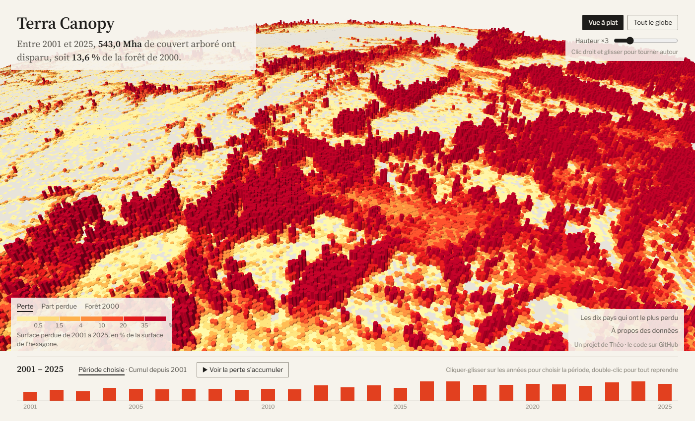

# Terra Canopy

Terra Canopy, c'est un globe qu'on peut faire tourner pour voir où les arbres ont disparu sur la planète entre 2001 et 2025. Je suis étudiant en géomatique, et je voulais un projet qui parte de vraies données satellite, très lourdes, pour arriver à quelque chose que n'importe qui peut ouvrir dans un navigateur. Les données viennent des cartes Global Forest Change de Hansen et al. : un pixel de 30 m pour toute la planète, avec le couvert arboré de 2000 et l'année où il a été perdu. Ça fait environ 100 Go de tuiles, donc impossible à afficher tel quel.

Projet réalisé par Théo ([theocode31](https://github.com/theocode31)).

Voir le site : [theocode31.github.io/TerraCanopy](https://theocode31.github.io/TerraCanopy/). Rien à installer, ça s'ouvre dans le navigateur.

[](https://theocode31.github.io/TerraCanopy/)

Le journal plus bas raconte comment le projet a avancé, avec les erreurs et ce que j'ai changé en route.

## Le journal

### 07/06/2026

Première idée du projet : une carte mondiale de la perte de forêt, en hexagones. J'ai créé le dépôt ce jour-là, mais je n'ai jamais poussé le code de cette première version, et je ne l'ai pas retrouvé sur mon PC. Leçon apprise un peu tard : pousser souvent.

### 06/11/2026

Je reprends tout de zéro. Le plus gros problème, c'est la taille des données : 280 tuiles de 10 x 10 degrés, avec deux couches chacune (couvert en 2000 et année de perte). Je n'ai pas la place de tout garder, donc le script télécharge une tuile, la résume, la supprime, et télécharge la suivante pendant le calcul. Il n'y a jamais plus de deux tuiles sur le disque. Je commence par les tropiques : si le calcul plante en route, la carte a déjà l'essentiel.

Pour résumer une tuile, je ne garde que les pixels avec plus de 30 % de couvert en 2000. Un pixel fait 0,00025 degré de côté, donc sa surface change avec la latitude. Je la calcule sur une sphère de même surface que l'ellipsoïde WGS84 (R = 6 371 007 m) : pour une ligne de pixels entre les latitudes φ1 et φ2, surface = R² × Δλ × |sin φ1 − sin φ2|.

Passer 1,6 milliard de pixels par tuile dans H3, ça prendrait des heures. Je regroupe donc d'abord les pixels en petites cellules, puis chaque cellule va dans l'hexagone qui contient son centre. Première version : des cellules de 0,05 degré et des hexagones de résolution 4 (environ 1 770 km²). Les 280 tuiles sont passées en 116 minutes, sans aucun échec.

### 07/11/2026, le matin

Le moment de vérité : est-ce que mes hexagones retombent sur les chiffres officiels ? Global Forest Watch donne 517 Mha de couvert arboré perdu entre 2001 et 2024. J'obtiens 517,4 Mha. Même chose pour 2001 (13,4 Mha) et 2024 (29,6 Mha). L'agrégation ne perd donc pas de surface en route.

Le site de cette première version était un planisphère sombre, en React et deck.gl.

### 07/11/2026, le soir

Le planisphère ne me plaisait pas. Trois choses à changer :

1. Un vrai globe qu'on fait tourner, comme si on regardait la Terre depuis l'espace. J'utilise la vue globe de deck.gl, avec l'océan, les pays et les hexagones dessinés directement sur la sphère. Plus besoin de fond de carte en ligne.
2. Des hexagones qui s'affinent quand on zoome. Le problème, c'est que les cellules de 0,05 degré (environ 5,5 km) sont trop grosses pour des hexagones de résolution 6, qui font environ 3,7 km de côté. J'ai donc refait l'agrégation avec des cellules de 0,01 degré (40 x 40 pixels). Je l'ai d'abord testée sur une tuile d'Amazonie (00N_060W). On obtient 31 049 hexagones au lieu de 682, avec les mêmes totaux : 112,18 Mha de forêt en 2000 et 17,157 Mha perdus. Les résolutions 5 à 2 sont simplement la somme des hexagones enfants.
3. Des couleurs qui gardent le même sens à tous les zooms. Avant, je colorais par septiles (chaque couleur = un septième des hexagones). Mais un hexagone de résolution 6 est 343 fois plus petit qu'un hexagone de résolution 3, donc des hectares perdus ne se comparent pas d'un zoom à l'autre. Maintenant, la carte montre la perte en % de la surface de l'hexagone, avec des seuils fixes (0,5 %, 1,5 %, 4 %, 10 %, 20 %, 35 %). Au début, je m'arrêtais à 10 %, mais une fois le calcul complet fini, j'ai vu que 72 % de la perte se trouvait dans des hexagones au-dessus de 10 % : Bornéo et le Rondônia étaient d'une seule couleur.

Le calcul complet a pris 104 minutes. Les totaux sont exactement ceux de la première version (3 995,3 Mha de forêt, 517,4 Mha perdus sur 2001-2024), donc changer la taille des cellules n'a rien cassé. Seuls les petits chiffres par pays bougent un peu, parce qu'un hexagone de frontière est maintenant plus petit.

La résolution 6, c'est 2,18 millions d'hexagones (ceux qui ont au moins 5 ha de forêt) et 189 Mo de données, beaucoup trop pour un seul fichier. Je les ai coupés en 1 798 paquets (tous les descendants d'un même hexagone 4 niveaux plus haut, 2 401 au plus), et le site ne charge que les paquets visibles à l'écran.

J'ai d'abord essayé un style clair, comme une page d'atlas.

### 07/11/2026, plus tard dans la soirée

Sur fond clair, la planète faisait plate et un peu terne. Je suis passé à un thème nuit : un ciel avec quelques étoiles, un océan bleu profond, et un halo d'atmosphère autour du globe. Pour placer le halo, je calcule le bord visible de la sphère, là où les rayons partis de la caméra la touchent juste, puis je le projette à l'écran. Comme ça, il suit le globe quand on zoome ou qu'on l'incline. Les couleurs sont maintenant comme des braises : sombre quand il y a peu de perte, de plus en plus lumineux quand il y en a beaucoup. Sur fond noir, c'est l'inverse de l'atlas, sinon ce sont les zones peu touchées qui sautent aux yeux.

J'ai aussi ajouté un mode relief 3D. Les hexagones deviennent des colonnes, et la caméra s'incline (clic droit et glisser pour tourner autour). La hauteur suit la racine carrée de la valeur affichée, et elle est rapportée à la taille des hexagones : 100 % donne une colonne de quatre côtés d'hexagone. La racine carrée, c'est pour que les petites pertes restent visibles sans que les plus grosses écrasent tout.



Dernier changement : la barre sur le côté faisait trop tableau de bord, avec ses onglets, son gros chiffre en couleur et ses jauges. Je l'ai enlevée. Le globe prend tout l'écran. En haut, il y a le titre et une phrase qui donne les chiffres de la période. En bas, la frise des années montre la perte mondiale par an, et on choisit la période directement dessus en cliquant-glissant. Le classement des pays et les notes sur les données s'ouvrent seulement si on clique dessus.

### 08/11/2026

En regardant le relief de plus près, on voyait mal la différence entre les zones. C'était la faute de la racine carrée : un hexagone à 35 % de perte n'était que 6 fois plus haut qu'un hexagone à 1 %, alors qu'il a perdu 35 fois plus. Maintenant la hauteur est proportionnelle à la valeur, donc une colonne deux fois plus haute veut vraiment dire deux fois plus de perte. Comme les petites valeurs deviennent du coup très basses, j'ai ajouté un curseur « hauteur » qui multiplie toutes les colonnes de ×1 à ×10 (×3 au départ). Il passe par l'échelle de la couche dans deck.gl, donc rien n'est recalculé et les colonnes suivent le curseur en direct.

Autre souci : quand je choisissais une seule année, presque toute la carte était de la couleur la plus sombre. C'est normal, puisque les seuils (0,5 % à 35 %) étaient faits pour 25 ans de perte. J'ai vérifié sur les hexagones de résolution 5 : avec 2010 seule, 86 % des hexagones tombaient dans la première classe, contre 36 % sur 2001-2025. Maintenant les seuils suivent la durée de la période. Ils sont multipliés par le nombre d'années divisé par 25, donc pour une seule année ils vont de 0,02 % à 1,4 %. Une même couleur veut alors dire la même perte moyenne par an, quelle que soit la période. Avec 2010 seule, il ne reste que 34 % des hexagones dans la première classe. J'ai préféré ça à des seuils recalculés sur les données affichées, parce qu'une grosse année comme 2016 doit rester plus chaude qu'une petite. La hauteur du relief suit la même règle. Il reste une différence : sur une seule année, la perte est plus concentrée, donc la dernière classe est plus remplie que sur 25 ans.

Dernier ajout de la soirée : un mode « cumul depuis 2001 ». La période part toujours de 2001, et on clique sur une année pour voir tout ce qui a été perdu jusque-là. Dans ce mode, les seuils restent ceux des 25 ans, sinon la carte garderait à peu près la même allure d'une année à l'autre. Le bouton « voir la perte s'accumuler » fait défiler les années de 2001 à 2025, une toutes les 0,7 seconde : la carte s'allume petit à petit et, en relief, les colonnes montent. J'aurais aimé un fondu entre deux années, mais la couche d'hexagones de deck.gl ne transmet pas les transitions à ses sous-couches, donc l'animation avance par à-coups, année par année.

### 08/11/2026, le soir

Le thème nuit restait trop sombre, et le halo autour de la Terre faisait un anneau opaque pas très beau. J'ai tout repris dans un style plus « écran de contrôle ». Le fond est un bleu nuit plus clair, avec une grille fine. Le halo est remplacé par un trait lumineux sur le bord du globe, et autour il y a un anneau gradué tous les 5 degrés, qui tourne quand on tourne la vue, avec deux arcs qui balaient le bord. En haut à droite, un relevé donne la position, le zoom et la résolution H3 affichée.

Les couleurs de la carte viennent maintenant de la palette « inferno » de matplotlib, du violet au jaune pâle, et « viridis » pour la forêt de 2000. Ces palettes sont faites pour que la clarté monte régulièrement d'une classe à l'autre, et elles restent lisibles avec un daltonisme. Je ne garde que la partie haute d'inferno (de 0,3 à 1), sinon la première classe serait presque noire sur le globe. Le cyan ne sert qu'à l'interface, jamais à coder une valeur.

J'ai aussi allégé le texte. Le choix de ce que montre la carte (perte, part perdue, forêt 2000) est passé du titre au-dessus de la légende, et la légende n'a plus qu'une phrase.

### 09/11/2026

Finalement le violet d'inferno pour les petites pertes ne rendait pas bien. La perte et la part perdue vont maintenant du jaune au rouge, avec 7 teintes de la palette YlOrRd de ColorBrewer. J'ai enlevé la teinte la plus pâle, presque blanche, et le bordeaux le plus sombre, qui se perdait sur le fond. La forêt de 2000 garde viridis.

Le style « écran de contrôle » faisait trop gadget, alors je suis reparti vers quelque chose de plus sobre, comme une carte de journal. Le fond est couleur papier, le titre et la phrase sont dans une police à empattements (Source Serif), et le reste en Libre Franklin. J'ai enlevé l'anneau gradué, les lueurs, la grille, les coins de visée, les étoiles et le relevé de position. Le globe a juste un trait gris fin autour, avec un océan gris-bleu et des terres beige clair. Le jaune-rouge est fait pour un fond clair, donc il marche mieux qu'avant. Pour que le texte reste lisible quand on zoome, il est posé sur des encarts couleur papier, qu'on ne voit pas quand le globe est en entier, et la frise est sur une bande pleine en bas. Le globe est aussi un peu plus petit au départ, pour ne plus passer sous la frise.

## Ce que montre la carte

| | Ce projet | Global Forest Watch |
|---|---|---|
| Perte 2001-2024 | 517,4 Mha | 517 Mha |
| Perte en 2001 | 13,4 Mha | 13,4 Mha |
| Perte en 2024 | 29,6 Mha | 29,6 Mha |

Sur 2001-2025, il y avait 3 995 Mha de couvert arboré en 2000 et 543 Mha ont été perdus, soit 13,6 %. La perte passe d'environ 16 Mha par an en 2001-2005 à environ 26 Mha par an en 2021-2025, avec un maximum en 2016 (29,7 Mha).

| Pays | Perte 2001-2025 | Couvert en 2000 | Part perdue |
|---|---|---|---|
| Russie | 91,7 Mha | 758 Mha | 12,1 % |
| Brésil | 76,5 Mha | 522 Mha | 14,7 % |
| Canada | 68,6 Mha | 416 Mha | 16,5 % |
| États-Unis | 51,0 Mha | 279 Mha | 18,3 % |
| Indonésie | 33,3 Mha | 162 Mha | 20,6 % |
| République démocratique du Congo | 22,4 Mha | 200 Mha | 11,2 % |
| Chine | 13,5 Mha | 163 Mha | 8,3 % |
| Bolivie | 10,5 Mha | 65 Mha | 16,3 % |
| Malaisie | 9,8 Mha | 29 Mha | 33,3 % |
| Australie | 9,6 Mha | 42 Mha | 22,7 % |

Ce qui m'a surpris : la Russie devant le Brésil, et le Canada troisième. En fait, perte de couvert arboré ne veut pas dire déforestation : les incendies et les coupes forestières qui repoussent comptent aussi, et c'est une grosse partie de la perte en Russie et au Canada.

## Les limites

- Les données ne disent pas pourquoi les arbres ont disparu (déforestation, feu, coupe, tempête).
- Les années ne sont pas parfaitement comparables : les satellites ont changé (Landsat 8 à partir de 2013) et il y a beaucoup plus d'images qu'au début des années 2000. Une partie de la hausse vient peut-être d'une meilleure détection.
- Une cellule de 0,01 degré va entièrement dans l'hexagone de son centre. Au bord des hexagones, un peu de surface passe chez le voisin. Le total ne bouge pas, mais la carte est un peu lissée.
- Un hexagone sur une frontière compte pour un seul pays (celui de son centre). Pour les petits pays, les chiffres sont approximatifs.

## Relancer le projet

Avec Python 3.11 ou plus :

```
pip install -r requirements.txt
python pipeline/lancer_pipeline.py      # télécharge et résume les 280 tuiles, reprend où il s'est arrêté
python pipeline/exporter_web.py         # écrit les fichiers du site dans web/public/data
```

Puis le site, avec Node 18 ou plus :

```
cd web
npm install
npm run dev
```

Les fichiers du site sont déjà dans `web/public/data`, donc on peut ouvrir le site sans refaire le pipeline. On peut partager une vue précise : l'adresse garde la position et le zoom (par exemple `#-62.8,-10.2,6.6` pour le Rondônia, ou `#-62.8,-10.6,6.4,55,25,3d` pour le même endroit en relief, incliné à 55°, et `#-62.8,-10.6,6.4,55,25,3d,x6` avec des colonnes deux fois plus hautes).

## Les fichiers

```
pipeline/
  agreger_tuile.py     une tuile Hansen -> hexagones H3 de résolution 6 (forêt 2000 et perte par an)
  lancer_pipeline.py   télécharge, résume et supprime les 280 tuiles, les tropiques d'abord
  exporter_web.py      fusionne les tuiles, calcule les résolutions 5 à 2 et les pays, coupe en paquets
web/
  src/App.jsx          le globe (deck.gl) et le choix de la résolution selon le zoom
  src/Panneau.jsx      le texte posé sur le globe : phrase de la période, frise des années, légende, pays, réglages
  src/donnees.js       chargement des paquets et sommes cumulées
  src/couleurs.js      couleurs et seuils
  public/data/         hexagones et résumés produits par le pipeline
```

## Sources

- Hansen, M. C. et al. (2013). High-Resolution Global Maps of 21st-Century Forest Cover Change. Science 342, 850-853. Données (version GFC-2025-v1.13, licence CC BY 4.0) : https://glad.earthengine.app/view/global-forest-change
- Global Forest Watch / WRI : https://gfr.wri.org/
- H3, la grille d'hexagones : https://h3geo.org/
- Natural Earth, pour les pays : https://www.naturalearthdata.com/
